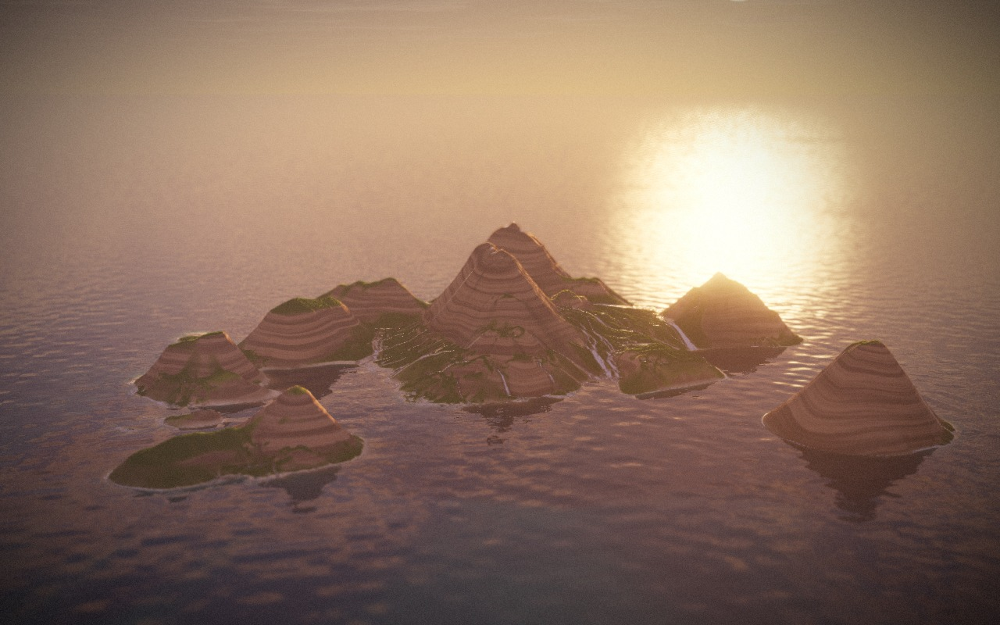
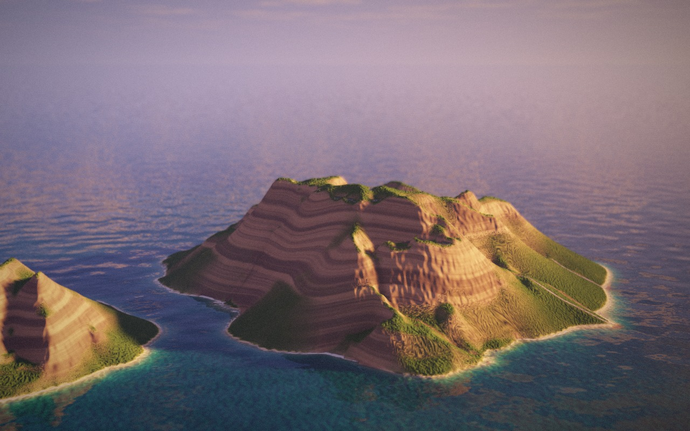
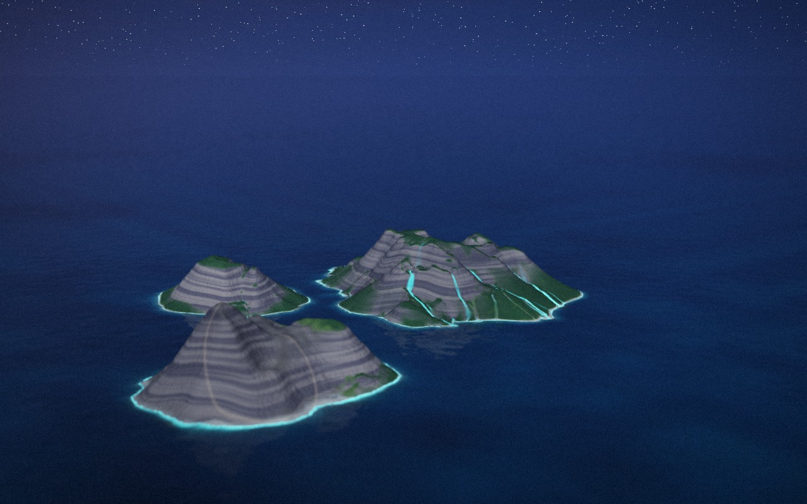

# Orogeny

Raise islands from the sea; rain, rivers and time do the rest.

An interactive procedural tech demo in one self-contained `index.html`: no libraries, no build
step, no assets. Every pixel and every sample is generated at runtime (WebGL2 + Web Audio).

**Play it:** https://codecoded.github.io/orogeny/

## Controls

| Input | Effect |
|---|---|
| Drag on land or sea | Raise land |
| Shift-drag, right-drag, or the arrow button / Space | Carve |
| Drag the sky or open sea, arrow keys / WASD | Turn and tilt the camera |
| Wheel or pinch | Zoom (the brush gets finer as you zoom in) |
| N | New world (the seed is in the URL hash) |
| M | Mute |
| Hold T | Fast-forward the sun |

## How it works

One 512² heightfield is the whole world: bedrock height, water depth, suspended sediment and
vegetation per cell. Three fragment passes simulate shallow water, sediment transport and
slumping; shadows and ambient occlusion are marched in the heightfield's own texture space; a
single raymarch renders it; and the same state, read back from the GPU, drives a synthesised
score.

