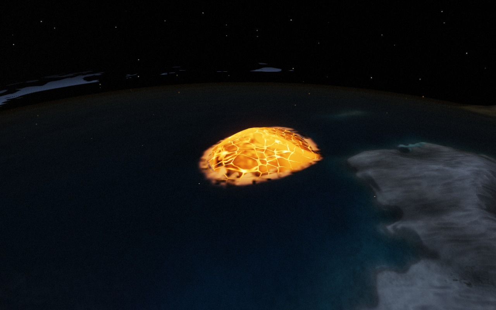
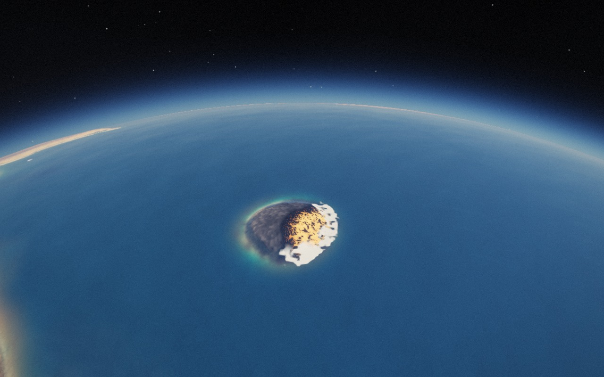
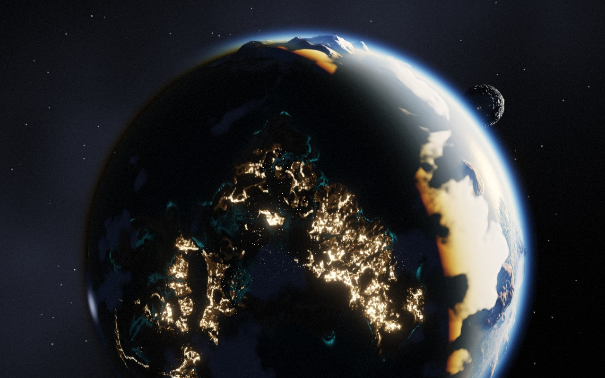
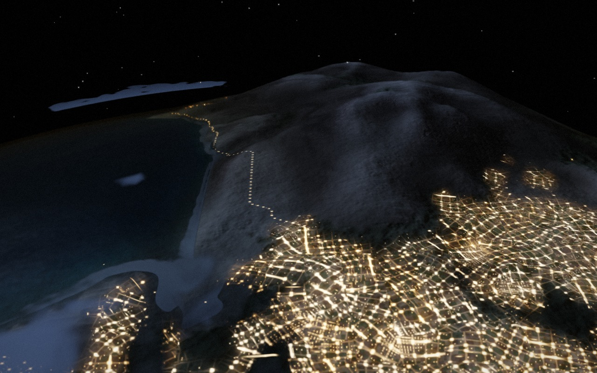
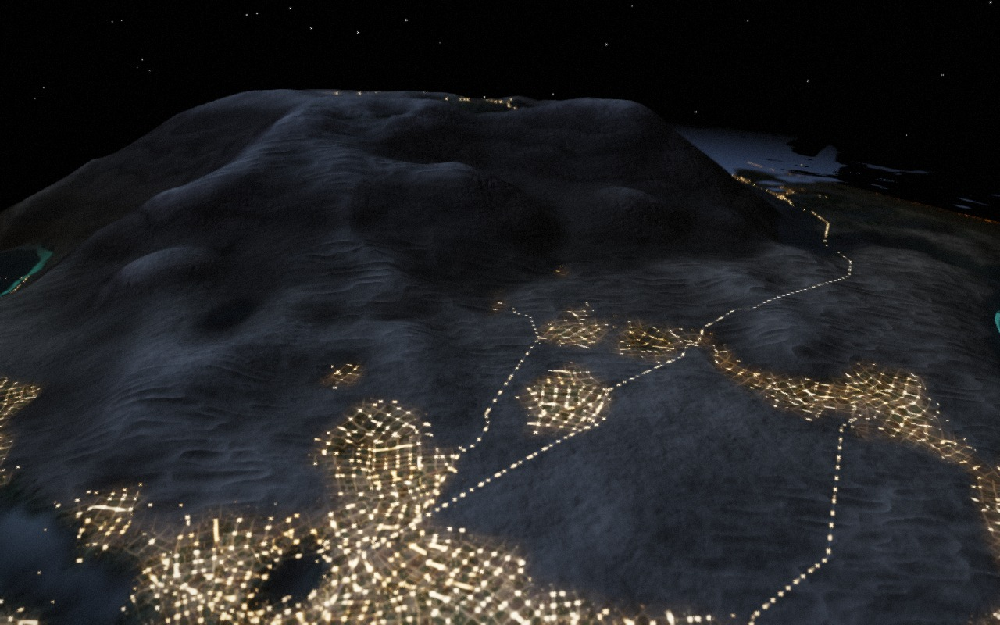
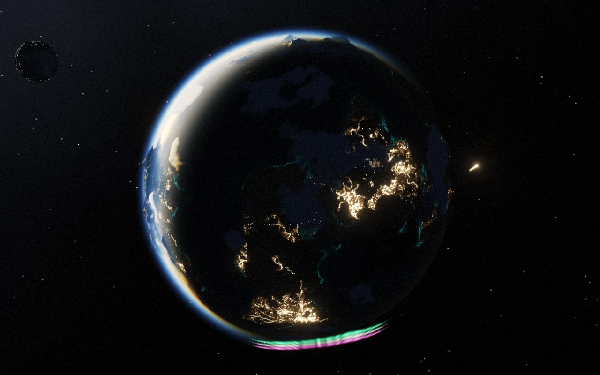
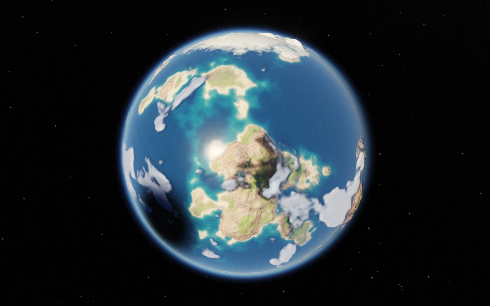
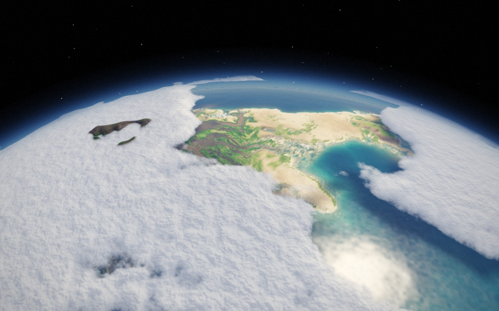
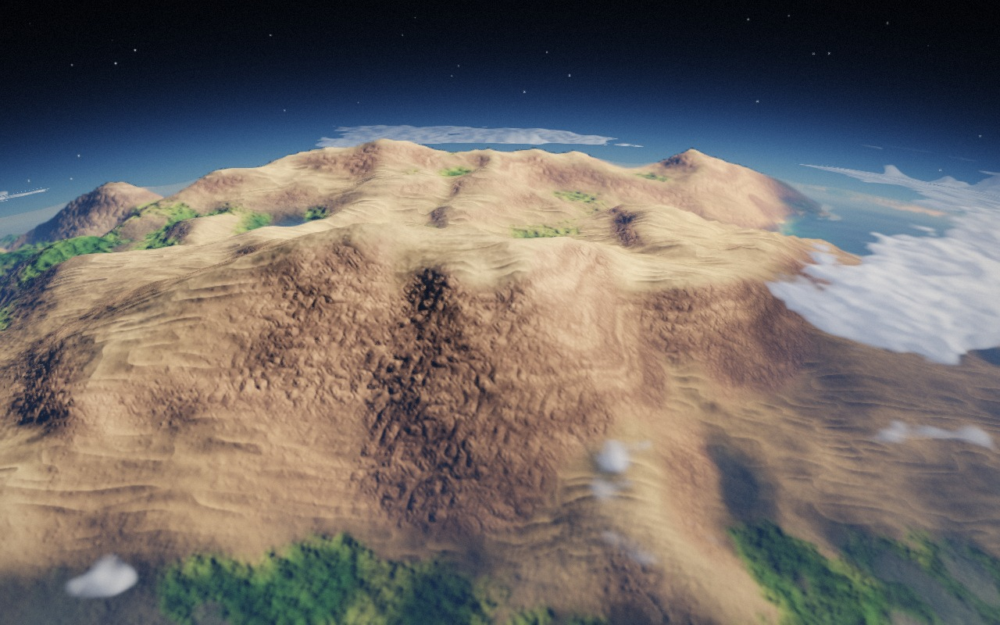

# Orogeny

A world you can hold, and its whole history. Push land up out of the sea of a small planet and
it comes as fire: lava that runs, cools and turns to ground. Wind, rain, rivers, tides, ice and
time do the rest. After a while something lights fires on the night side. The fires become
towns, the towns wear roads between them, and one day a spark leaves for the moon.

An interactive procedural tech demo in one self-contained `index.html`: no libraries, no build
step, no assets. Every pixel and every sample is generated at runtime (WebGL2 + Web Audio).

**Play it:** https://codecoded.github.io/orogeny/

## Controls

| Input | Effect |
|---|---|
| Drag on the planet | Raise land |
| Shift-drag, right-drag, or the arrow button / Space | Carve |
| Drag on space, arrow keys / WASD | Turn the planet |
| Wheel or pinch | Descend until the mountains fill the view, or pull back |
| N | New world (the seed is in the URL hash) |
| M | Mute |
| Hold T | Fast-forward |

Time is tied to distance: from far orbit the world ages quickly, and close to the ground it
slows to an afternoon. Left alone, an unseen hand keeps sculpting.

## What happens

Nothing here is scripted except the last step. Roughly, from far orbit:

- **At once:** land rises under your hand with lava along its crests. The lava runs downhill,
  crusts over, hisses where it meets the sea, and leaves black rock that weathers over an age.
- **Always:** a moon circles. It drags two tides round the planet, so beaches and mudflats
  appear and drown; it lights the night side; every so often its shadow crosses the day side,
  and half a lap later it turns copper in the planet's shadow.
- **After a minute or so:** fires on the night side, then towns on gentle, green ground above
  the tide line, with fields round them by day.
- **After two:** roads between the towns, lamps along them at night, boats off the busy coasts.
  Carve a pass through a range, or close a strait, and the roads find it.
- **After three or so:** a ship climbs from the largest city and crosses to the moon. A light
  comes on there. Others follow, and satellites stay behind.

Ice ages still come and go, and they can undo most of it.

## How it works

The whole planet is one square texture folded onto a sphere with an octahedral map, so there
are no poles to pinch and no seams: each edge of the square is glued to itself, mirrored, and
the simulation's neighbour lookups follow that fold. Per cell it holds bedrock height, water
depth, suspended sediment, vegetation, ice, soil moisture, people, lava, and the way to town.

One rule is used four times: a cell hands something to a lower neighbour.

- **Water and rock.** Shallow water in "virtual pipes", sediment transport and talus slumping,
  three fragment passes per step. Rock hardness varies by place and by layer. The moon's tidal
  potential is subtracted from the surface the water runs down, so the tides are real flow, with
  currents in the straits.
- **Lava.** A second, slower fluid on the same grid: it moves only while hot, needs a steeper
  drop as it cools, quenches at once under water, and whatever freezes is added to the bedrock.
- **Roads.** Each cell keeps a toll: the effort of reaching somewhere busier than itself by its
  cheapest neighbour (distance, made worse by slopes, water and ice). Everyone in a cell sets
  off that way, and the count passing through is the road. A road lowers the toll, so paths
  gather into highways. Travellers keep to the way already taken unless another is clearly
  better, which stops two routes trading traffic for ever. The result looks like a river
  network because it is one.
- **Weather.** Moisture evaporates from warm sea, is carried on the winds (trades, westerlies,
  eddies and drifting cyclones), and falls wherever air is made to rise, above all on the
  windward side of mountains. The far side stays dry, so the ranges you raise decide where the
  deserts are. Eruptions add steam and ash to the same air.
- **Climate and life.** Ice gathers where it is cold and the sea falls as it does. Soil
  moisture remembers rain and seeps outward from rivers. Vegetation follows moisture and
  warmth. People settle green, gentle ground near water.
- **Light.** Single scattering through an exponential atmosphere with a closed-form optical
  depth, so sunsets, the blue limb and the ring of light round an eclipsed planet all come from
  one small loop. Sun shadows and ambient occlusion are marched in the planet's own map. The
  moon's shadow is tested at every sample of the air as well as on the ground, which is why
  the sky dims with the land.
- **Close up.** One cell of the map then covers many pixels, so the picture switches to cubic
  filtering and draws relief the grid cannot hold as bumps: gullies on bare rock, dunes on sand,
  wind wrinkles on water. Each octave fades out before it gets finer than a pixel. A town's glow
  comes apart the same way, into avenues, then streets, then single lamps: streets run where
  the ground cuts three families of planes, so each district gets a square or triangular plan
  at its own angle. A road becomes the exact chain of cell-to-cell steps its travellers take,
  with lamps at even paces and headlights running toward town.
- **Sound.** Synthesised with Web Audio and mixed by what the camera is looking at.

## The earlier version

Orogeny began as a single patch of sea with islands. That version is kept at
[`islands/`](islands/) and plays at https://codecoded.github.io/orogeny/islands/.

