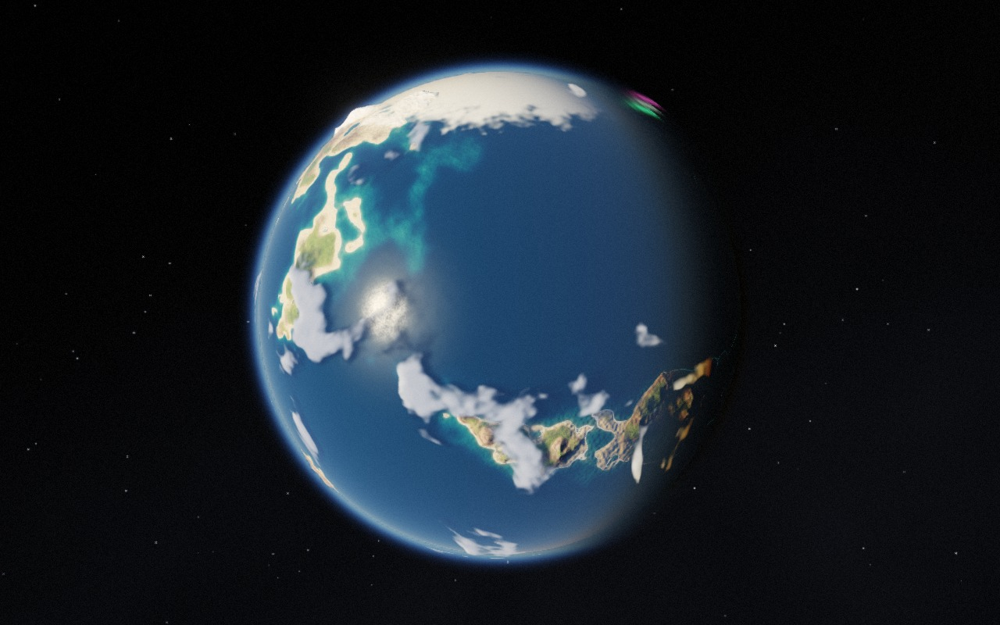
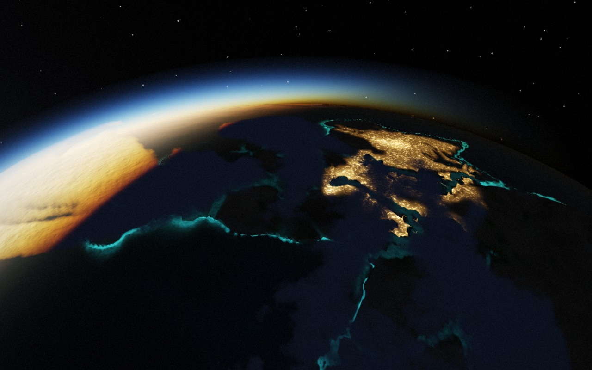
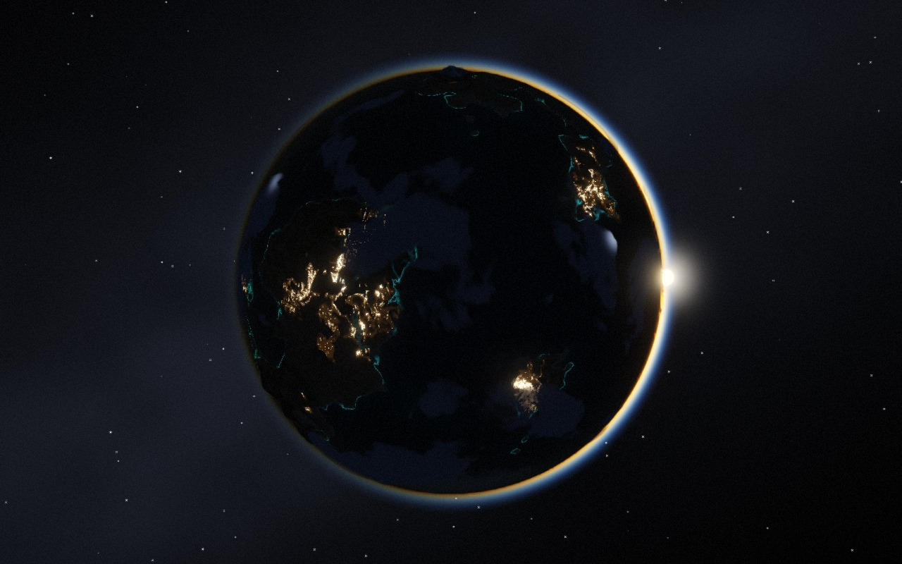
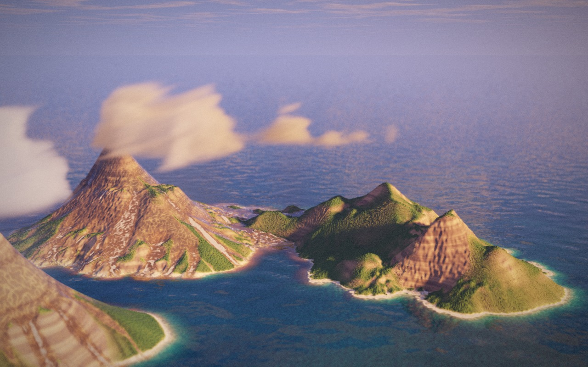

# Orogeny

A world you can hold. Raise land from the sea of a small planet; wind, rain, rivers, ice and
time do the rest, and after a while something starts lighting fires on the night side.

An interactive procedural tech demo in one self-contained `index.html`: no libraries, no build
step, no assets. Every pixel and every sample is generated at runtime (WebGL2 + Web Audio).

**Play it:** https://codecoded.github.io/orogeny/

## Controls

| Input | Effect |
|---|---|
| Drag on the planet | Raise land |
| Shift-drag, right-drag, or the arrow button / Space | Carve |
| Drag on space, arrow keys / WASD | Turn the planet |
| Wheel or pinch | Descend to low orbit, or pull back |
| N | New world (the seed is in the URL hash) |
| M | Mute |
| Hold T | Fast-forward |

Time is tied to distance: from far orbit the world ages quickly, and close to the ground it
slows to an afternoon. Left alone, an unseen hand keeps sculpting.

## How it works

The whole planet is one square texture folded onto a sphere with an octahedral map, so there
are no poles to pinch and no seams: each edge of the square is glued to itself, mirrored, and
the simulation's neighbour lookups follow that fold. Per cell it holds bedrock height, water
depth, suspended sediment, vegetation, ice, soil moisture and people.

- **Water and rock.** Shallow water in "virtual pipes", sediment transport and talus slumping,
  three fragment passes per step. Rock hardness varies by place and by layer.
- **Weather.** Moisture evaporates from warm sea, is carried on the winds (trades, westerlies,
  eddies and drifting cyclones), and falls wherever air is made to rise, above all on the
  windward side of mountains. The far side stays dry, so the ranges you raise decide where the
  deserts are.
- **Climate and life.** Ice gathers where it is cold and the sea falls as it does. Soil
  moisture remembers rain and seeps outward from rivers. Vegetation follows moisture and
  warmth. People settle green, gentle ground near water, and their lights show at night.
- **Light.** Single scattering through an exponential atmosphere with a closed-form optical
  depth, so sunsets, the blue limb and the ring of light round an eclipsed planet all come from
  one small loop. Sun shadows and ambient occlusion are marched in the planet's own map.
- **Sound.** Synthesised with Web Audio and mixed by what the camera is looking at.

## The earlier version

Orogeny began as a single patch of sea with islands. That version is kept at
[`islands/`](islands/) and plays at https://codecoded.github.io/orogeny/islands/.

